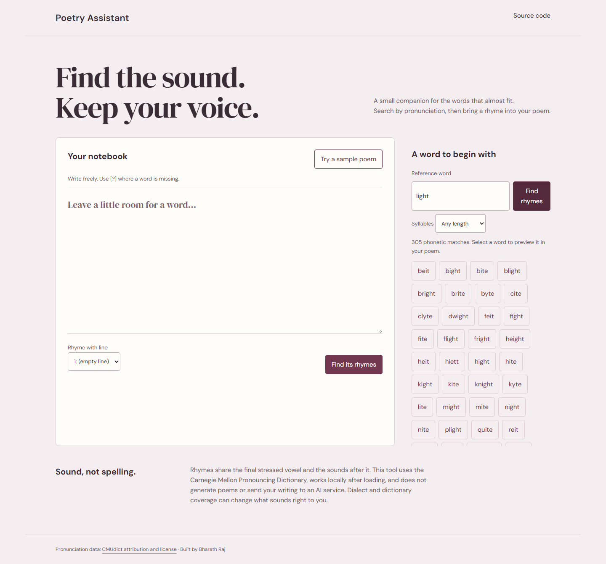

# Poetry Assistant

Words that look alike do not always rhyme. This tool helps a writer search by pronunciation and preview a word in a poem without replacing their voice.



## Demo

[Open the live demo](https://bharath-raj-official.github.io/poetry-assistant/). Local setup is also available below.

## What it does

- One notebook for rhyme search and missing-word completion.
- Local CMU pronunciation dictionary, alternate pronunciations and phonetic rhyme groups.
- Syllable filtering, sample poem, reference-line selection and selectable suggestions.
- Explicit replacement preview and apply/cancel; unknown words have a useful response.
- Arbitrary poem text is rendered safely as text; no generated-poetry or AI claims.

## Run locally

```sh
python -m http.server 8000 --bind 127.0.0.1
```

Open http://127.0.0.1:8000/ in a modern browser. Run the command inside this repository. Do not open `index.html` directly from disk: local datasets/model assets use HTTP. Python 3 is only a local static server; no application build is required.

## Controls

Search a reference word or choose a poem line and select Find its rhymes. Put `[?]` in your poem, choose a suggestion, review the preview, then select Use this word. Syllable filtering applies to suggestions. Writing stays in the current tab and is not persisted after a refresh.

## Architecture and decisions

`rhyme-engine.js` parses local CMUdict and groups pronunciations from the final stressed vowel through the end, removing numeric stress markers for matching. `app.js` builds the notebook UI with textContent and form values. A pending replacement is applied only if the original poem has not changed. The old coursework pages and personal reports are kept only as private workspace reference, outside the publishable project.

## Limitations

English dictionary coverage and dialect affect results. Proper names may appear because CMUdict includes them. Perfect rhymes are phonetic matches, not a quality ranking; semantics, meter and poetic style remain the writer’s decision. Results display at most 250 suggestions. There is no suffix-guess fallback for unknown words.

## Validation

Fixtures include light/night and cat/bat, cough/though rejection, syllable filtering and unknown words. Edge verifies sample replacement preview/apply and safe rendering of HTML-like poem text.

## Third-party attribution

CMUdict from cmusphinx/cmudict; complete license at `data/CMUDICT-LICENSE.txt`. Bundled dictionary SHA-256: `81917843c7f44ce2b094ac63873c2c7a4cf802040792c455ba3ca406891c3d22`. DM Sans/DM Serif Display via Google Fonts.

